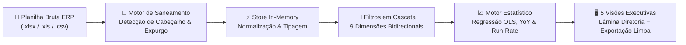
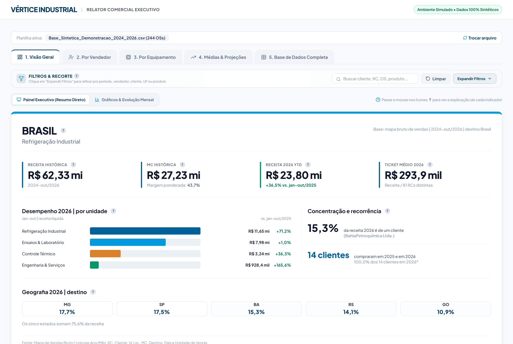
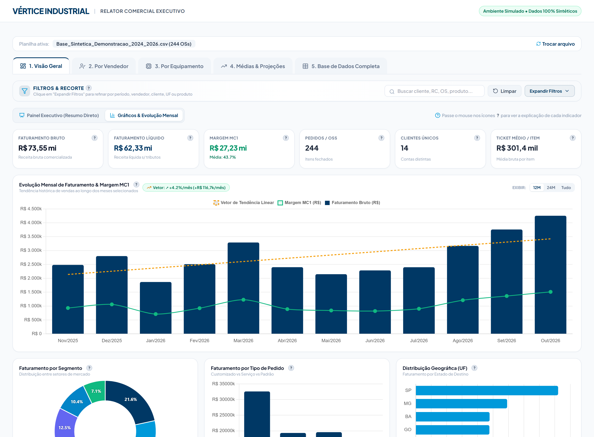
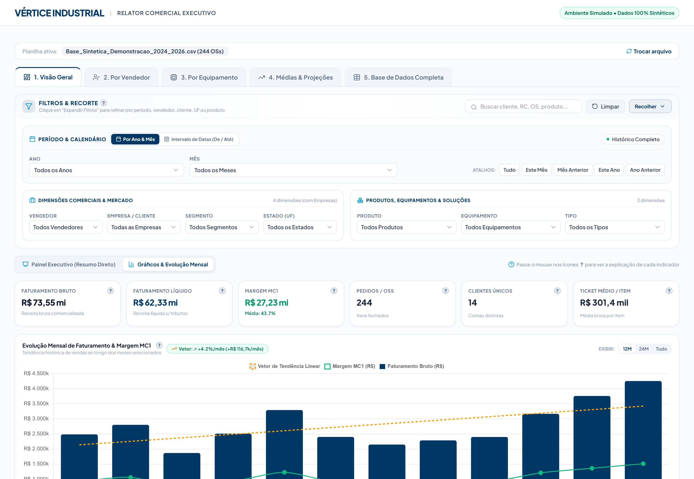
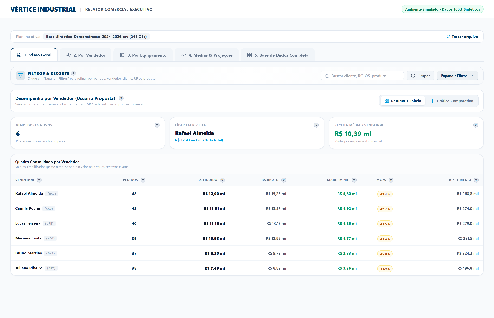
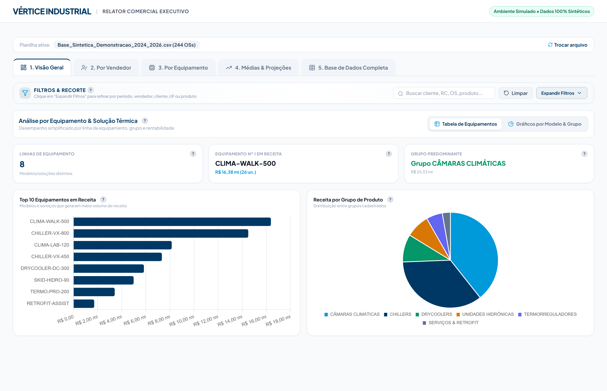
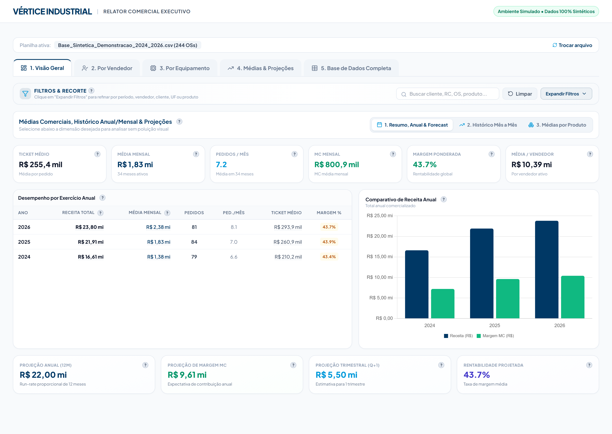

# 📊 Relator Comercial — Motor de BI Executivo & Analytics Offline


> **Estudo de Caso de Engenharia de Software & Simulação Interativa**  
> Sistema analítico de *Business Intelligence* (BI) client-side projetado para transformar exportações brutas e complexas de ERPs industriais (`.xlsx` / `.csv`) em **lâminas executivas de diretoria, projeções estatísticas OLS e análises multidimensionais em cascata**, operando **100% offline** e sem custos de licenciamento em nuvem.

🔗 **[Acessar Simulação Interativa Ao Vivo (GitHub Pages)](https://sambassoii.github.io/relator-bi-comercial/)**  
🔗 **Projeto Complementar (Ecossistema Comercial):** [Declarador Comercial — Full-Stack CRM Analytics & Streaming ETL](https://github.com/SamBassoIi/declarador-crm-analytics)

---

## 🛡️ Nota de Confidencialidade & Conformidade (LGPD / Sigilo Industrial)

Este repositório foi construído exclusivamente para **fins de portfólio técnico e demonstração arquitetural**:
- **Zero Código ou Esquema Proprietário:** Regras de negócio internas, mapeamentos específicos de ERP e binários corporativos foram integralmente omitidos.
- **100% Dados Sintéticos:** Todas as capturas de tela e a simulação interativa utilizam uma empresa industrial fictícia (*Vértice Industrial*) e dados gerados algoritmicamente (clientes, vendedores, códigos de produtos e valores simulados).

---

## 🎯 O Problema de Negócio

Em operações industriais B2B de médio e grande porte, relatórios gerenciais exportados de sistemas ERP legados costumam apresentar desafios críticos para a tomada de decisão rápida:
1. **Planilhas densas e despadronizadas** (dezenas de colunas técnicas, células mescladas, linhas em branco e rodapés de `=SUBTOTAL` misturados aos registros).
2. **Lentidão na preparação de reuniões executivas**, exigindo horas de limpeza manual no Excel a cada fechamento mensal.
3. **Restrições severas de segurança da informação**, onde dados estratégicos de faturamento e margem de contribuição não podem ser enviados para serviços externos de terceiros na nuvem.

## 💡 A Solução Arquitetada

O **Relator Comercial** resolve esse gargalo processando, higienizando e modelando toda a base diretamente na memória do navegador (`Client-Side In-Memory BI`), entregando um painel fluido com **zero instalação de servidor** e inicialização instantânea via navegador ou *launcher* nativo Windows:



---

## ⚙️ Destaques Técnicos de Engenharia

- **🧹 Saneamento Heurístico de Planilhas (`Smart Header & Subtotal Purge`):**
  Varre dinamicamente as linhas iniciais para localizar o cabeçalho verdadeiro, normaliza valores monetários multiformato e elimina linhas órfãs de totalização (`TOTAL GERAL`, `=SOMA`, `=SUBTOTAL`) sem descartar clientes reais cujas razões sociais contenham a palavra *"Total"*.
- **🔀 Filtragem Facetada em Cascata Bidirecional ($O(N)$):**
  9 filtros multi-seleção interconectados (*Ano, Mês, Vendedor, Cliente, Família, Equipamento, Tipo, Segmento e UF*), busca textual instantânea e atalhos temporais que recalculam todos os KPIs, tabelas e gráficos em poucos milissegundos.
- **📐 Regressão Linear Simples por Mínimos Quadrados Ordinários (OLS):**
  Implementação matemática nativa em JavaScript que calcula inclinação de tendência mensal ($\beta_1$ em R$/mês), coeficiente de determinação ($R^2$), média móvel de 3 meses (MMS 3M) e projeção *Run-Rate* anualizada.
- **🖼️ Lâmina Executiva Pronta para Reunião de Diretoria:**
  Consolida em uma única tela os *Hero KPIs* (Receita Histórica, Margem de Contribuição, YTD com variação *YoY* e Ticket Médio), concentração de carteira (*Top Account Share*), recorrência de clientes e distribuição geográfica por UF.
- **📦 Arquitetura 100% Offline-First & Exportação Auditável:**
  Todas as dependências gráficas e de parsing operam localmente, garantindo soberania total dos dados e permitindo reexportar a base higienizada em `.xlsx` multi-abas ou `.csv` UTF-8 BOM.

---

## 🖥️ Galeria de Telas (Ambiente Simulado — Dados 100% Sintéticos)

### 1. Lâmina Executiva de Diretoria (Visão Geral)
Consolidação automática de KPIs históricos, crescimento *Year-over-Year (YoY)*, desempenho por unidade de negócio, recorrência de clientes e ranking geográfico por estado.


### 2. Evolução Mensal, Regressão Linear (OLS) & Gráficos de Mix
Série histórica combinando faturamento líquido, margem de contribuição e reta de tendência estatística OLS com seletor temporal (`12M / 24M / Tudo`).


### 3. Central de Filtros Multidimensionais em Cascata
Painel retrátil com 9 dimensões simultâneas, seleção por intervalo de datas ou competência e *chips* ativos de recorte dinâmico.


### 4. Performance Comercial por Vendedor
Ranking comparativo de carteira com volume de pedidos, receita bruta/líquida, margem de contribuição (R$ e %), ticket médio e *share* percentual.


### 5. Análise de Portfólio & Mix de Equipamentos
Curva dos 10 modelos de maior impacto financeiro e participação percentual por família tecnológica de produto.


### 6. Médias Históricas & Projeções Anuais (*Run-Rate*)
Comparativo interanual automatizado e estimativa estatística de fechamento anual e trimestral baseada no ritmo operacional vigente.


---

## 🚀 Como Executar a Simulação Interativa Localmente

Este repositório inclui uma **simulação web interativa (`index.html`)** construída do zero com geração de dados sintéticos em tempo real:

```bash
# Clone o repositório
git clone https://github.com/SamBassoIi/relator-bi-comercial.git
cd relator-bi-comercial

# Abra index.html diretamente no navegador ou inicie um servidor estático:
python -m http.server 8080
```
Acesse `http://localhost:8080` ou teste diretamente pelo **[GitHub Pages](https://sambassoii.github.io/relator-bi-comercial/)**.

---

## 👨‍💻 Autor

Desenvolvido por **Samuel de Oliveira Bassoli**  
[](https://www.linkedin.com/in/samueldeoliveirabassoli/)
[](https://github.com/SamBassoIi)
